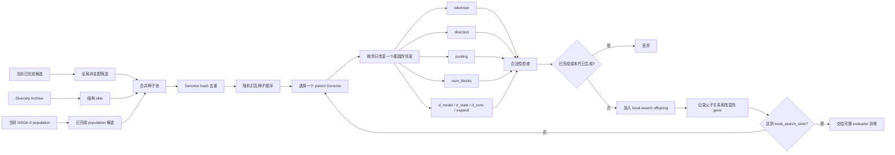

# `archive_local_search` 具体流程图

下面的流程对应当前代码中的原始 `archive_local_search`，不包含 `archive_local_search_v2` 的 Macro/Micro Archive 和分层多起点策略。

## 总体流程

```mermaid
flowchart TD
    A[开始：读取 SearchConfig] --> A1{配置是否合法?}
    A1 -- 否 --> A2[报错并终止]
    A1 -- 是 --> B[加载 TRAIN.ts]

    B --> C{验证协议}
    C -- holdout --> C1[按 seed 创建或恢复固定 80/20 分层划分]
    C -- kfold --> C2[按 seed 创建或恢复固定 stratified K-fold 划分]
    C1 --> D[保存 manifest.json 与划分文件]
    C2 --> D

    D --> E[创建 CandidateEvaluator]
    E --> E1[拟合每个 fold 的归一化统计量]
    E1 --> E2[加载 evaluations.jsonl 中已完成候选]
    E2 --> E3[计算全搜索空间 MACs 上界]
    E3 --> F[创建 DiversityArchive]
    F --> F1[将缓存候选按结构生态位更新档案]
    F1 --> F2[写入 variant.json 与 diversity_archive.csv]
    F2 --> G[创建 NSGA-II]
    G --> G1[整数随机初始化 / 交叉 / 类别变异]
    G1 --> H{恢复任务?}
    H -- 是 --> H1[读取 search_state.pkl]
    H1 --> H2[校验 validation、seed、variant 和比例]
    H2 --> H3[恢复算法状态、随机数状态和缓存]
    H -- 否 --> I[初始化第一代 Genome 种群]
    H3 --> J
    I --> J[进入搜索循环]

    J --> K{候选预算仍未耗尽?}
    K -- 否 --> Z[生成最终 Pareto 前沿]
    K -- 是 --> L{当前代是否初始化完成?}
    L -- 否 --> M[评价初始种群]
    L -- 是 --> N[生成混合 offspring]

    N --> N0[计算本代 offspring 总预算]
    N0 --> N1[局部搜索槽位 = ceil(offspring × 0.30)]
    N1 --> LS[构造局部搜索种子池]

    LS --> LS1[全局已完成候选的非支配解]
    LS --> LS2[Diversity Archive 结构精英]
    LS --> LS3[当前 NSGA-II 种群中已完成候选]
    LS1 --> LS4[按 Genome hash 去重并随机打乱]
    LS2 --> LS4
    LS3 --> LS4
    LS4 --> LS5[按 gene 顺序枚举一阶邻居]
    LS5 --> LS6[tokenizer / direction / pooling / num_blocks]
    LS6 --> LS7[d_model / d_state / d_conv / expand]
    LS7 --> LS8[只保留合法且未访问邻居]
    LS8 --> LS9{局部搜索槽位已填满?}
    LS9 -- 否 --> LS5
    LS9 -- 是 --> LS10[记录 parent_hash、child_hash、changed_gene]
    LS10 --> O[写入局部搜索 offspring]

    O --> P[按完整 offspring 预算补充随机移民]
    P --> P1[默认约 10% 总 offspring]
    P1 --> Q[当前种群 + Diversity Archive 父代池]
    Q --> Q1[默认约 60% 当前种群、30% 档案父代]
    Q1 --> Q2[均匀交叉 + 类别变异]
    Q2 --> Q3[Genome hash 去重]
    Q3 --> Q4{offspring 数量足够?}
    Q4 -- 否 --> Q5[随机合法 Genome 补齐]
    Q4 -- 是 --> R[得到本代 offspring]
    Q5 --> R

    M --> S[调用 CandidateEvaluator.evaluate]
    R --> S
    S --> S1{候选是否命中 completed cache?}
    S1 -- 是 --> S2[直接复用已完成指标]
    S1 -- 否 --> S3[按 fold 训练候选 Mamba]
    S3 --> S4[训练集拟合归一化；验证集只做评估]
    S4 --> S5[记录 loss、Macro-F1、Accuracy、参数量和 MACs]
    S5 --> S6[写入候选目录、evaluations.jsonl/csv]
    S6 --> S7[补充 created_by、parent_hash、generation 等元数据]
    S2 --> T[返回候选目标值]
    S7 --> T
    T --> T1[目标：1 - Macro-F1 与 log(1 + MACs)]
    T1 --> U[NSGA-II 合并父代与 offspring]
    U --> U1[目标空间非支配排序]
    U1 --> U2{是否启用决策空间拥挤?}
    U2 -- 否 --> U3[标准目标空间拥挤距离截断]
    U2 -- 是 --> U4[目标拥挤与架构拥挤混合截断]
    U3 --> V[形成下一代种群]
    U4 --> V

    V --> W[更新 Diversity Archive]
    W --> W1[按 tokenizer、direction、capacity_level 分生态位]
    W1 --> W2[生态位内局部非支配筛选]
    W2 --> W3[每个生态位最多 3 个 elite]
    W3 --> W4[按目标拥挤 + 决策距离截断]
    W4 --> W5[写入 diversity_archive.csv]
    W5 --> W6[记录 generation_diversity.csv]
    W6 --> X[保存 generation snapshot 与 search_state.pkl]
    X --> K

    Z --> Z1[全局 completed cache 执行 nondominated]
    Z1 --> Z2[写入 pareto_front.csv]
    Z2 --> Z3[选择 high_f1、knee、low_macs]
    Z3 --> Z4[写入 representatives.json]
    Z4 --> Y[搜索结束]
    Y --> Y1[refit 阶段用 TRAIN 全量训练]
    Y1 --> Y2[仅此时访问 TEST]
    Y2 --> Y3[输出 TEST Macro-F1、Accuracy、Parameters、MACs]
```

## 局部搜索分支的细化



## 单个候选的评价流程

```mermaid
flowchart TD
    A[Genome] --> B{completed cache 命中?}
    B -- 是 --> C[复用历史 row]
    B -- 否 --> D[估计 MACs]
    D --> E[为每个 holdout/K-fold 划分建立模型]
    E --> F[只用训练子集拟合 normalization]
    F --> G[训练 MambaTSCClassifier]
    G --> H[验证集计算 Macro-F1 与 Accuracy]
    H --> I[保存 history.csv、metrics.json、val_predictions.npz]
    I --> J{候选训练成功?}
    J -- 否 --> K[记录 failures.jsonl 并重试]
    K --> L[失败候选写入失败状态]
    J -- 是 --> M[汇总 fold 指标]
    M --> N[objective_f1 = 1 - Macro-F1]
    N --> O[objective_macs = log(1 + MACs)]
    O --> P[写入 evaluations.jsonl/csv]
    C --> Q[返回目标值]
    P --> Q
```

## 关键数据产物

每个运行目录下的关键文件及作用如下：

| 文件 | 作用 |
|---|---|
| `manifest.json` | 保存数据集、验证协议、seed 和完整搜索配置 |
| `search/variant.json` | 保存当前搜索机制和比例 |
| `search/evaluations.csv` | 所有已完成候选及其指标 |
| `search/evaluations.jsonl` | 候选评价的可恢复日志 |
| `search/diversity_archive.csv` | 结构档案中的局部精英 |
| `search/local_search.csv` | 局部搜索父子关系、改变的基因和子代结果 |
| `search/generation_diversity.csv` | 每代 HV、Pareto size、结构覆盖率等统计 |
| `search/generations/generation_XXXX.csv` | 当前代种群快照 |
| `search/generations/generation_XXXX_pareto.csv` | 截止该代的全局 Pareto 前沿 |
| `search/search_state.pkl` | 恢复搜索所需的 NSGA-II 和随机数状态 |
| `search/pareto_front.csv` | 搜索结束时的全局非支配候选 |
| `search/representatives.json` | `high_f1`、`knee`、`low_macs` 三个代表架构 |

## 论文中可以怎样解释这张图

这套流程不是把档案和局部搜索当作新的优化目标，而是在 NSGA-II 外层增加两个搜索控制机制：

```text
目标空间：Macro-F1 与 MACs 的 Pareto 排序
决策空间：结构生态位和局部精英记忆
邻域空间：单基因变更的一阶局部开发
```

因此，`archive_local_search` 的方法逻辑是：

1. 用 NSGA-II 识别当前性能—成本折中较好的区域；
2. 用 Diversity Archive 保存结构上不同、且在各自生态位内有竞争力的候选；
3. 从全局 Pareto 和结构档案附近系统检查一阶邻居；
4. 在不增加总候选预算的前提下，将局部搜索结果与随机移民、交叉变异结果共同交给 evaluator；
5. 通过真实训练结果决定新候选是否进入全局 Pareto 前沿。

需要强调：结构档案和局部搜索只改变“候选如何产生和保留”，不改变最终的 Macro-F1/MACs Pareto 支配定义。最终代表架构仍然只从全局 Pareto 前沿中选择。

