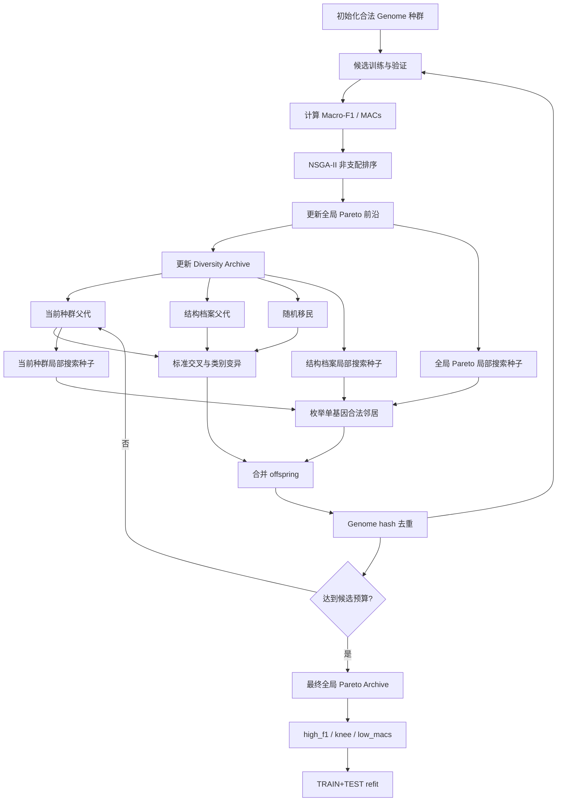

# Mamba-NAS：面向时间序列分类的结构多样性保持与 Pareto 局部搜索

本文档根据当前 `archive_local_search` 的实际代码实现整理，目标是提供一条可以直接扩展成论文的故事线。文中默认方法是原始组合方法，不包含后续 `archive_local_search_v2` 的 Macro/Micro Archive 和分层多起点策略。

## 0. 为什么选择 Mamba 作为搜索模型

论文的第一层动机不应直接从“NSGA-II 存在什么问题”开始，而应先说明为什么 Mamba 值得被作为搜索对象。Mamba 是一种选择性状态空间模型，能够以近似线性的计算和存储开销建模较长序列中的依赖关系。对于时间序列分类，这一点具有三方面价值：

1. **适合长程依赖建模。** 时间序列中的判别信息可能跨越较长时间范围，例如心电、动作和交通传感器数据中，局部片段的含义往往依赖于较远位置的上下文。Mamba 通过状态空间递推压缩历史信息，能够在较低复杂度下传播长程信息。
2. **比全局注意力更适合成本受限搜索。** Transformer 类模型的注意力计算通常随序列长度呈二次增长，而 Mamba 的扫描式状态空间计算更接近线性。这使得 MACs、参数量和序列长度之间的权衡更适合被放入多目标 NAS，而不是只追求单一分类精度。
3. **结构配置具有明确的归纳偏置。** Mamba 模型的效果不仅取决于隐藏维度，还受到输入 tokenizer、扫描方向、层数、状态维度、局部卷积宽度、扩展倍率以及时间聚合方式的共同影响。不同配置会对应不同的时间分辨率、信息传播路径和容量分配，因此 Mamba 天然提供了一个具有研究价值的离散架构搜索空间。

换句话说，选择 Mamba 不是因为它只是一个新的分类器，而是因为它同时满足：

```text
具有时间序列建模优势
+ 具有较好的计算效率
+ 存在丰富且可解释的结构配置
```

这也带来一个新的问题：Mamba 的候选结构虽然具有明确的设计含义，但不同结构之间的性能差异、成本差异和数据集依赖性很强。手工选择单一 Mamba 配置难以覆盖不同时间序列的归纳需求，因此需要多目标架构搜索在性能与成本之间寻找一组可解释的 Pareto 解。

## 一句话主线

基于 Mamba 的时间序列模型具有长程建模和计算效率优势，但其 tokenizer、扫描方向、容量和聚合方式会形成复杂的离散归纳偏置。传统 NSGA-II 可以在 Macro-F1 与计算成本之间寻找 Pareto 解，却容易在这个离散空间中出现结构坍缩：少数 tokenizer、扫描方向或容量配置长期占据种群，使搜索看似收敛，实际上只探索了很少的归纳偏置。

本文提出 `archive_local_search`：用结构感知的外部档案保存暂时被全局目标支配、但属于稀有结构生态位的候选，再从全局 Pareto 解、结构档案和当前种群附近枚举合法的单基因邻居。前者负责“保留可能有价值的结构”，后者负责“开发高价值结构周围的局部区域”。因此，NSGA-II 负责全局 Pareto 收敛，结构档案负责结构多样性，Pareto 局部搜索负责离散邻域开发。

## 1. 论文题目建议

### 主标题

**Diversity-Preserving Pareto Local Search for Multi-Objective Mamba Architecture Search in Time-Series Classification**

中文可写为：

**面向时间序列分类的多目标 Mamba 架构搜索：结构多样性保持与 Pareto 局部搜索**

### 更强调问题的标题

**Preventing Architectural Collapse in Multi-Objective Mamba-NAS via Structural Archives and Single-Gene Pareto Local Search**

这个标题更适合你的实验结果确实能够证明：结构覆盖率提高，同时 Hypervolume 或 TEST Macro-F1 没有明显下降。

## 2. 摘要草稿

时间序列分类中的状态空间模型具有较强的长程建模能力，但其 tokenizer、扫描方向、容量和聚合方式之间存在显著的离散组合效应。现有多目标神经架构搜索通常只依据分类性能和计算成本进行 NSGA-II 选择，容易使少数结构在种群中反复繁殖，导致 Pareto 前沿的结构多样性不足，并削弱对不同时间序列归纳偏置的探索能力。

为此，本文提出一种结构多样性保持的多目标 Mamba 架构搜索方法。该方法在 Macro-F1 和 MACs 的 Pareto 搜索之外，引入外部 Diversity Archive，将候选按照 tokenizer、扫描方向和容量等级划分为结构生态位，并在每个生态位内维护局部非支配精英。进一步地，本文从历史全局 Pareto 架构、结构档案和当前种群中选择局部搜索种子，枚举只改变一个架构基因的合法邻居，以提高离散搜索空间中的邻域开发能力。局部搜索不会改变候选总预算，所有邻居仍由完整训练评估，从而保证与原始 NSGA-II 的比较公平。

在 Heartbeat、SpokenArabicDigits、UWaveGestureLibrary 和 PEMS-SF 等具有不同样本规模、类别平衡性和输入维度的数据集上，本文比较 Vanilla NSGA-II、结构档案、局部搜索及二者组合。实验重点考察最终 Hypervolume、Hypervolume-AUC、结构覆盖率、Tokenizer/Direction Coverage、架构距离、搜索成本以及独立 TEST Macro-F1。结果用于回答两个问题：结构档案能否减少架构结构坍缩，以及单基因局部搜索能否提高离散邻域产生非支配解的能力。

## 3. 引言的故事线

推荐将引言组织成以下递进关系：

```text
Mamba 为什么适合时间序列分类
→ Mamba 的结构配置为什么值得搜索
→ 时间序列数据为什么需要多个不同归纳偏置
→ 现有多目标 NAS 为什么会发生结构坍缩
→ Diversity Archive 与 Pareto Local Search 如何解决该问题
```

这样，方法不是为了修补一个抽象的 NSGA-II，而是服务于一个清晰的研究对象：在保持 Mamba 长程建模和计算效率优势的同时，为不同时间序列寻找合适的结构归纳偏置。

### 3.1 背景：Mamba 适合时间序列，但架构配置具有强离散性

时间序列分类同时依赖局部模式、长程依赖和有效的序列聚合。Mamba 的选择性状态空间建模为长序列提供了线性复杂度的建模路径，但模型效果并不只由隐藏维度决定。以下配置都可能改变模型的归纳偏置：

- `tokenizer`：逐点输入或 patch 化输入，决定时间分辨率与局部聚合方式；
- `direction`：单向或双向扫描，决定信息传播方向；
- `num_blocks`、`d_model`：决定宏观容量；
- `d_state`、`d_conv`、`expand`：决定状态空间和局部卷积容量；
- `pooling`：决定最终时间维聚合方式。

因此，单一手工配置难以适用于具有不同长度、噪声、类别不平衡和通道规模的 UEA 时间序列数据集。

### 3.2 现有多目标 NAS 的问题

本文不把问题描述成“NSGA-II 不能搜索”，而是更准确地指出：

1. **目标空间收敛不等于决策空间覆盖。** Macro-F1/MACs 的非支配关系只关心性能和成本，不关心两个候选是否来自完全不同的结构家族。
2. **离散搜索空间存在结构坍缩。** 一旦某个 tokenizer 或方向配置在早期获得较好的 F1/成本折中，它会被 NSGA-II 反复选择，其他结构即使具有潜在价值，也可能因早期训练噪声而消失。
3. **随机变异对高价值区域的开发不充分。** 标准交叉和随机类别变异可以跳转到新区域，但不能系统地检查一个已知优秀架构的单基因邻域。

由此得到本文的核心判断：

> Mamba-NAS 的困难不只是找到目标空间中的高分点，还要在有限候选预算内同时保持结构家族覆盖，并有效开发 Pareto 解附近的离散邻域。

### 3.3 本文的解决思路

本文将搜索过程拆成三个互补角色：

| 模块 | 解决的问题 | 在算法中的职责 |
|---|---|---|
| NSGA-II | F1 与 MACs 的全局折中 | 非支配排序、生存选择、全局收敛 |
| Diversity Archive | 结构家族被早期淘汰 | 保存每个结构生态位的局部精英，并参与繁殖 |
| Pareto Local Search | 优秀架构附近探索不足 | 枚举一阶合法邻居，开发局部 Pareto 改进 |

三者不是三个独立目标，而是对同一个多目标搜索过程的三个互补层次：目标空间、结构决策空间和局部邻域空间。

## 4. 搜索问题定义

### 4.1 架构编码

每个候选架构由 8 个离散基因组成：

```text
g = (tokenizer, num_blocks, direction, d_model,
     d_state, d_conv, expand, pooling)
```

当前搜索空间大小为：

```text
3 × 3 × 2 × 2 × 2 × 2 × 2 × 3 = 864 个合法 Genome
```

Genome 使用实际枚举值进行验证和哈希。例如，`point`、`patch8` 和 `patch16` 是三个离散 tokenizer 选项，而不是连续数值 0、1、2。

### 4.2 双目标优化

候选架构在固定验证协议下训练，得到 Macro-F1 和 MACs。为了适配 NSGA-II 的最小化形式，代码使用：

```math
f_1(g) = 1 - \operatorname{MacroF1}(g)
```

```math
f_2(g) = \log(1 + \operatorname{MACs}(g))
```

搜索目标为：

```math
\min_g \; (f_1(g), f_2(g)).
```

其中 TEST 数据只在代表架构确定后的 refit 阶段访问。搜索阶段只读取 TRAIN 数据，并使用固定 holdout 或固定 K-fold 划分，保证所有候选在同一评价协议下比较。

## 5. 方法一：结构 Diversity Archive

### 5.1 结构生态位

代码用以下粗粒度结构签名定义生态位：

```python
structure_key = (genome.tokenizer,
                 genome.direction,
                 capacity_level)
```

容量等级定义为：

```text
small  : d_model=64 且 num_blocks=1
large  : d_model=128 且 num_blocks=3
medium : 其余组合
```

因此最多有：

```text
3 tokenizer × 2 direction × 3 capacity = 18 个结构生态位
```

这里的生态位不是新的优化目标，也不会改变全局 Pareto 支配关系。它只是为结构保留提供一个外部组织方式。

### 5.2 局部非支配精英

当候选完成训练后，代码将它加入对应生态位，并只在该生态位内部执行非支配筛选：

```text
局部 Pareto = local_nondominated(existing_niche ∪ new_candidate)
```

每个生态位最多保留 3 个候选。超过上限时，使用目标空间拥挤度与架构空间最近距离的混合分数截断：

```math
S_i = 0.7 \cdot C_i^{obj} + 0.3 \cdot C_i^{dec}
```

其中：

- `C_obj` 是 Macro-F1/MACs 目标空间拥挤度；
- `C_dec` 是同一生态位内的 Genome 架构距离；
- 0.7/0.3 只用于同一生态位内的精英截断，不参与全局 Pareto 支配。

因此，档案最多保存约 `18 × 3 = 54` 个结构精英，但实际数量取决于已经访问的生态位以及局部非支配关系。

### 5.3 档案的作用

结构档案解决的是“暂时被全局目标支配但结构上值得保留”的问题。例如，一个 `point` 或 `bidirectional` 架构可能在早期训练噪声下不如 `patch8 + forward`，但它代表完全不同的归纳偏置。只要它在自己的结构生态位内保持局部非支配，就有机会继续作为父代参与后续搜索。

论文中建议把这种作用称为：

> structure-aware survival memory

不要表述成“档案保证所有结构都能进入最终 Pareto 前沿”。它只能增加这些结构被继续探索的机会，最终是否优于其他架构仍由真实候选评价决定。

### 5.4 档案参与父代生成

启用档案后，父代来源的设计意图为：

```text
约 60%：当前 NSGA-II 种群
约 30%：Diversity Archive
约 10%：随机移民
```

实现上，随机移民先占用完整 offspring 预算的 10%，剩余候选通过当前种群和档案父代进行交叉/变异；档案父代概率经过归一化，使整体比例近似上述配置。所有候选都通过 Genome hash 去重，避免缓存和重复训练。

## 6. 方法二：Pareto 单基因局部搜索

### 6.1 邻域定义

给定父架构 `g`，一阶邻域只改变一个基因：

```math
N_1(g) = \{g' : \text{g' 与 g 恰好有一个基因不同}\}.
```

例如：

```text
point       → patch8 / patch16
forward     → bidirectional
mean        → max / meanmax
num_blocks=1 → 2 / 3
d_model=64  → 128
```

当前 8 维空间中，一个 Genome 最多有 11 个一阶邻居。代码设置 `local_search_max_neighbors=12` 作为安全上限，因此通常可以覆盖完整一阶邻域。

### 6.2 局部搜索种子

原始 `archive_local_search` 从三类已完成候选中构造种子池：

1. 所有已完成候选中的全局非支配架构；
2. Diversity Archive 中的结构精英；
3. 当前 NSGA-II 种群中已经完成评价的候选。

种子去重后随机打乱，避免固定顺序让某一种来源永久占据局部搜索预算。这里没有使用性能预测器，也没有根据未训练邻居的预测分数做预筛；每个被选中的合法邻居最终都进入原有 evaluator 进行完整训练。

### 6.3 局部搜索预算

每代局部搜索候选数为：

```python
local_search_slots = ceil(population_size * 0.30)
```

这些槽位从总 offspring 预算中划出，不会额外增加候选总数。剩余槽位由随机移民和标准 NSGA-II 交叉/类别变异补齐。因此不同搜索变体仍可以在相同 `max_unique_candidates` 下公平比较。

### 6.4 局部搜索的搜索逻辑

代码按以下基因顺序枚举邻居：

```text
tokenizer → direction → pooling → num_blocks
→ d_model → d_state → d_conv → expand
```

对于每个种子：

1. 生成所有只改变一个基因的合法邻居；
2. 截取 `local_search_max_neighbors` 个邻居；
3. 去除已在 completed cache 或本代已生成集合中的 Genome；
4. 将未访问邻居加入 offspring；
5. 记录 parent hash、child hash、changed gene、父代指标和子代指标。

局部搜索不是递归爬山：新生成的子代不会在同一代继续扩展邻居。这样可以限制计算成本，并使每个候选的来源和预算清晰可追踪。

## 7. 完整算法流程

当前实现的展开版流程图单独整理在：[ARCHIVE_LOCAL_SEARCH_FLOW_CN.md](ARCHIVE_LOCAL_SEARCH_FLOW_CN.md)。该文件进一步展示了缓存命中、局部搜索槽位、随机移民、档案更新、搜索恢复和候选预算终止条件。



可以把这一流程概括为：

```text
NSGA-II 负责“往哪里收敛”
结构档案负责“哪些结构不能过早消失”
局部搜索负责“如何把优秀区域搜细”
```

## 8. 方法的核心假设

论文不要直接声称方法一定更好，而应提出三个可检验假设。

### H1：结构档案减少结构坍缩

相对于 Vanilla NSGA-II，启用 Diversity Archive 后应观察到：

```text
Structure Coverage ↑
Tokenizer Coverage ↑
Direction Coverage ↑
平均 Genome 距离 ↑
```

同时 Final Hypervolume 不应出现明显下降。

### H2：局部搜索提高邻域开发效率

相对于仅使用随机交叉/变异的 NSGA-II，局部搜索子代应具有：

```text
更高的正 ΔMacro-F1 比例
更高的 Pareto entry rate
更高的平均 Hypervolume contribution
```

这里的“正 ΔMacro-F1”是子代 Macro-F1 减父代 Macro-F1；它是诊断指标，不是搜索目标本身。

### H3：档案与局部搜索具有互补性

单独使用档案主要改善结构覆盖，单独使用局部搜索主要改善邻域开发；二者组合应在相同候选预算下同时保持较高结构覆盖和较好的最终 Hypervolume/TEST Macro-F1。

## 9. 实验设计与对照组

### 9.1 最小消融矩阵

| 组别 | 方法 | 作用 |
|---|---|---|
| A0 | Vanilla NSGA-II | 基线，全局目标空间搜索 |
| A1 | NSGA-II + Diversity Archive | 验证结构保留是否有效 |
| A2 | NSGA-II + Pareto Local Search | 验证邻域开发是否有效 |
| A3 | NSGA-II + Archive + Local Search | 验证两个机制是否互补 |

如果论文最终只保留一个方法，建议先固定 A3 为主方法候选，再根据结果决定是否保留 A1/A2 作为分析方法。不要把 `dual_crowding` 混入这一条主线，除非你想额外讲“目标空间拥挤与决策空间拥挤”的另一种机制。

### 9.2 公平性控制

所有方法应固定：

```text
相同数据划分
相同 NAS seeds
相同 population_size
相同 max_unique_candidates
相同训练 epochs / patience
相同 MACs 估计方式
相同 refit seeds
```

最重要的是：局部搜索只能重新分配 offspring 预算，不能让组合方法偷偷训练更多候选。

### 9.3 推荐数据集分工

可以沿用不同数据集承担不同验证任务：

| 数据集类型 | 主要验证点 |
|---|---|
| Heartbeat | 小样本、不平衡条件下结构保留是否稳定 |
| SpokenArabicDigits | 大样本、性能接近饱和时局部搜索是否仍有收益 |
| UWaveGestureLibrary | 中等规模、动作模式和方向归纳偏置 |
| PEMS-SF | 高维输入下 F1 与计算成本的折中 |

## 10. 指标如何支撑故事

### 10.1 搜索收敛指标

- **Final Hypervolume**：最终 Pareto 前沿覆盖的目标空间面积，越大越好；
- **Hypervolume-AUC**：搜索过程中 HV 曲线的面积，衡量收敛速度和全过程效率；
- **Pareto size**：最终非支配解数量，只作为辅助指标，不能单独证明方法更好；
- **Unique evaluations**、**training seconds**：搜索成本。

### 10.2 结构多样性指标

- **Structure Coverage**：Pareto 架构或当前种群覆盖的结构生态位比例；
- **Tokenizer Coverage**：Pareto 中出现的 tokenizer 比例；
- **Direction Coverage**：Pareto 中出现的 forward/bidirectional 比例；
- **Shannon Entropy**：tokenizer、direction、pooling 分布均衡度；
- **Mean Genome Distance**：Pareto 架构间平均加权 Hamming 距离。

架构距离使用实际枚举值比较，而不是整数索引的欧氏距离：

```math
d_{arch}(a,b)=\sum_i w_i \mathbf{1}[a_i\neq b_i].
```

其中 tokenizer 和 direction 权重为 2.0，宏观容量相关基因为 1.0，局部容量基因为 0.5。

### 10.3 局部搜索诊断指标

- **Positive ΔF1 rate**：局部搜索子代相对父代 Macro-F1 提升的比例；
- **Pareto entry rate**：局部搜索子代最终进入全局 Pareto 的比例；
- **Mean HV contribution**：进入 Pareto 的局部子代对 HV 的平均增量；
- **Changed-gene contribution**：统计 tokenizer、direction、pooling 等基因变化带来的有效子代比例；
- **Slot fill rate**：请求的局部搜索槽位中实际填充的比例。

### 10.4 最终泛化指标

代表架构 `high_f1`、`knee`、`low_macs` 在 TEST 上独立 refit 后报告：

```text
Macro-F1 mean ± std
Accuracy mean ± std
Parameters
MACs
OOF/validation → TEST gap
```

最终 TEST 只用于代表架构的泛化评估，不能反过来参与搜索和档案更新。

## 11. 结果部分建议按什么顺序讲

### RQ1：NSGA-II 是否存在结构坍缩？

先展示 A0 的 Pareto 散点图和结构统计：

```text
Pareto 前沿中 tokenizer 是否集中？
bidirectional 是否几乎消失？
Mean Genome Distance 是否很小？
```

这一节的目标不是证明 baseline 性能差，而是证明“只看目标空间会损失结构覆盖”。

### RQ2：Diversity Archive 是否保留了稀有结构？

比较 A0 与 A1：

```text
Structure Coverage
Tokenizer/Direction Coverage
Mean Genome Distance
Final HV
```

理想结果是 A1 结构覆盖提高，同时 HV 下降不明显。如果 A1 只增加了结构数量而造成明显 F1/HV 损失，应诚实地说明档案的代价，并分析其适用范围。

### RQ3：Pareto Local Search 是否比随机变异更会开发局部区域？

比较 A0 与 A2，并直接读取 `search/local_search.csv`：

```text
Positive ΔF1 rate
Pareto entry rate
Mean HV contribution
changed_gene 分布
```

重点解释局部搜索不是增加预算，而是将一部分随机 offspring 改造成有明确父代和单基因变化的候选。

### RQ4：两个机制是否互补？

比较 A3 与 A1/A2：

```text
A1：结构覆盖强，但局部开发有限
A2：局部开发强，但稀有结构可能仍然消失
A3：同时拥有结构记忆和邻域开发
```

如果 A3 的 TEST Macro-F1、HV 和结构覆盖都不差于单模块，应将其定义为最终方法。若 A3 只提高结构覆盖但 HV 和 TEST F1 下降，则应将“覆盖增加”和“搜索有效”区分开，不能直接声称组合成功。

## 12. 论文贡献点建议

建议最终只保留以下三个贡献点，避免把实现细节写成过多贡献：

1. **结构感知的多目标 Mamba-NAS。** 将 tokenizer、扫描方向和宏观容量组成结构生态位，在不改变全局 Pareto 支配关系的情况下保持离散架构多样性。
2. **预算受限的 Pareto 单基因局部搜索。** 从全局 Pareto、结构档案和当前种群中选择种子，系统评估合法一阶邻域，并把局部搜索限制在总 offspring 预算内。
3. **面向时间序列 NAS 的多层次评估协议。** 同时报告目标空间收敛、结构覆盖、局部搜索有效性和独立 TEST 泛化，从而区分“找到更好的架构”和“搜索得更广”。

## 13. 需要谨慎的表述

以下说法不建议直接写进论文：

- “Diversity Archive 保证 point 和 bidirectional 最终进入 Pareto 前沿。”
- “局部搜索一定比随机变异更优。”
- “Pareto 前沿数量越多，方法越好。”
- “结构多样性本身证明了泛化性能提升。”
- “档案中的候选没有被全局 Pareto 支配。”

更准确的写法是：

> Diversity Archive 为结构上稀有且在局部生态位内具有竞争力的候选提供持续繁殖机会；Pareto Local Search 对高价值架构的一阶离散邻域进行系统开发。二者是否提升最终泛化，需要通过固定预算下的 Hypervolume、结构覆盖和独立 TEST 评估共同验证。

## 14. 与当前代码的对应关系

| 论文概念 | 实现位置/产物 |
|---|---|
| Genome 编码 | `mamba_nas/search_space.py` |
| Mamba 分类器与 tokenizer/direction/pooling | `mamba_nas/model.py` |
| 目标函数 `1-Macro-F1`、`log(1+MACs)` | `mamba_nas/search.py` |
| 全局非支配排序 | `nondominated()` |
| 结构生态位 | `structure_key()`、`capacity_level()` |
| 结构档案 | `DiversityArchive` |
| 局部档案精英截断 | `DiversityArchive.update()` |
| 一阶邻域 | `one_gene_neighbors()` |
| 局部搜索 offspring | `_local_search_vectors()` |
| 混合 offspring 生成 | `_make_hybrid_infill()` |
| 局部搜索诊断 | `search/local_search.csv`、`generation_diversity.csv` |
| Pareto 代表架构 | `select_representatives()` |
| 独立 TEST refit | `mamba_nas/refit.py` |

## 15. 最终可直接用于答辩的总结

本文的核心并不是简单地“给 NSGA-II 加一个档案和一个局部搜索器”，而是针对 Mamba 时间序列架构搜索中的两个具体失配进行修正：

```text
目标空间的 Pareto 选择 ≠ 决策空间的结构多样性
随机变异的全局探索 ≠ 高价值离散邻域的充分开发
```

因此，`archive_local_search` 形成了一条清晰的算法叙事：

```text
NSGA-II 找到性能—成本折中区域
→ Diversity Archive 防止稀有结构过早消失
→ Pareto Local Search 检查这些高价值结构的一阶邻域
→ 在固定候选预算下获得更广且更细的架构搜索
→ 从最终全局 Pareto 前沿选择 high_f1、knee、low_macs
→ 只在 refit 阶段访问 TEST，验证真实泛化能力
```

如果实验结果支持这一叙事，论文的结论应写成：

> 在相同搜索预算下，结构档案改善了架构结构覆盖，单基因 Pareto 局部搜索提高了高价值邻域的有效探索率；二者组合在不显著损失目标空间收敛和 TEST Macro-F1 的前提下，缓解了 Mamba-NAS 中的结构坍缩问题。
