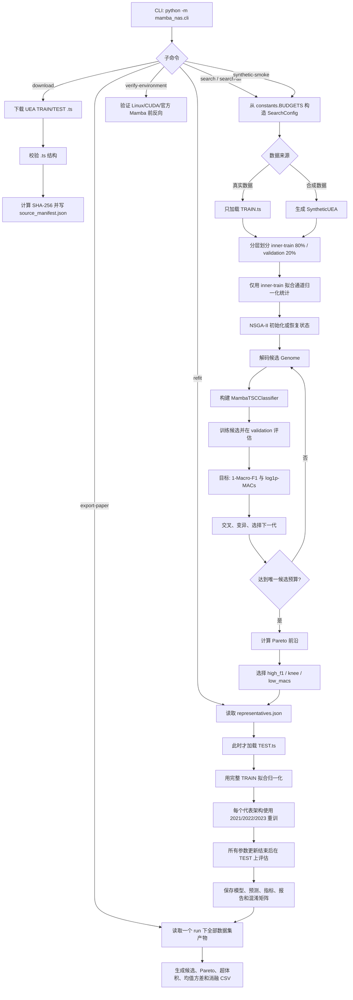
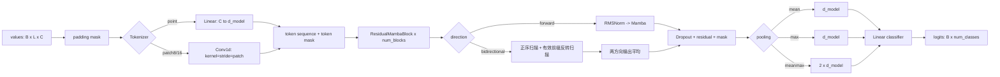
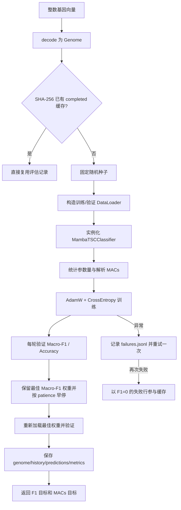

# `mamba_nas` 项目整理与代码流程分析

> 分析范围：`./mamba_nas`。本文基于当前源码整理，描述的是代码实际行为，而不是预期设计。

## 1. 项目定位

`mamba_nas` 是一个独立的多变量时间序列分类神经架构搜索（NAS）子项目，目标是在 UEA 数据集上搜索 Mamba 分类器架构。它与仓库原有的 `run.py`、`models/`、`exp/`、`data_provider/` 训练链路隔离，不会导入或修改这些模块。

项目的核心组合是：

- 分类骨干：官方 `mamba_ssm.Mamba`；
- 搜索算法：`pymoo` 的 NSGA-II；
- 优化目标：同时最小化 `1 - macro_f1` 和 `log(1 + MACs)`；
- 数据约束：搜索阶段只读取 `{dataset}_TRAIN.ts`，选择代表架构之后，重训阶段才读取 `{dataset}_TEST.ts`；
- 最终输出：搜索记录、Pareto 前沿、代表架构、多随机种子测试结果以及论文汇总表。

默认支持 `UEA10` 中的 10 个数据集，也提供合成数据用于快速检查流水线。

运行流程：
```text
# 1. 环境检查
python -m mamba_nas.cli verify-environment

# 2. 下载数据
python -m mamba_nas.cli download --suite uea10

# 3. 小规模验证
python -m mamba_nas.cli search \
  --dataset Heartbeat \
  --budget smoke \
  --run-id heartbeat-smoke-001

# 4. 确认 smoke 成功后正式搜索
python -m mamba_nas.cli search-all \
  --suite uea10 \
  --budget paper \
  --run-id uea10-paper-001

# 5. 三个代表架构重训练
python -m mamba_nas.cli refit \
  --run uea10-paper-001

# 6. 导出论文数据
python -m mamba_nas.cli export-paper \
  --run uea10-paper-001
```

## 2. 目录与模块职责

```text
mamba_nas/
├── cli.py                 # 命令行入口，分发 download/search/refit/export 等命令
├── constants.py           # UEA10、默认路径、smoke/paper 预算的实际定义
├── config.py              # SearchConfig 数据类及预算构造
├── data.py                # 下载、.ts 解析、划分、归一化、补齐和 DataLoader
├── search_space.py        # 8 维离散搜索空间、Genome 编解码与哈希
├── operators.py           # 类别型均匀交叉、重采样变异及 pymoo 适配
├── model.py               # Tokenizer、Mamba 残差块、池化和分类器
├── training.py            # 搜索期训练、最终定长重训、推理评估
├── metrics.py             # Macro-F1、Accuracy 和概率转换
├── logging_utils.py       # 过程日志与最终 TEST 结果的文件输出
├── macs.py                # 架构 MACs 解析估算与参数量统计
├── search.py              # NSGA-II 搜索主流程、候选评估、缓存和断点续跑
├── refit.py               # Pareto 代表架构在完整 TRAIN 上三种子重训
├── profiling.py           # CUDA 延迟与峰值显存测量
├── export.py              # 汇总搜索/重训产物，生成论文表格数据
├── artifacts.py           # JSON/CSV/Pickle 原子写入等产物工具
├── configs/
│   ├── smoke.yaml         # 预算参数副本；当前运行代码不会读取
│   └── paper.yaml         # 预算参数副本；当前运行代码不会读取
├── tests/                 # 搜索空间、模型、数据隔离、恢复、导出等测试
└── README.md              # 子项目的简短边界说明
```

## 3. 整体流程



流程中最重要的数据隔离点是：搜索阶段的 `run_search()` 调用 `load_train()`，不会经过 TEST 加载入口；`load_test_for_refit()` 只在 `refit_dataset()` 中、代表架构已经确定之后调用。

## 4. 命令行入口与运行方式

命令入口位于 `cli.py::main()`，推荐始终从仓库根目录使用模块方式执行。

### 4.1 环境验证

```bash
python -m mamba_nas.cli verify-environment
```

该命令检查 Linux、PyTorch、CUDA，并用官方 `mamba_ssm.Mamba` 完成一次前向和反向传播。正式搜索使用官方 Mamba，测试代码中的轻量 mixer 只用于 CPU 单元测试，不是搜索后端。

### 4.2 下载数据

```bash
# 下载 UEA10 全部数据集
python -m mamba_nas.cli download --suite uea10

# 仅下载一个数据集
python -m mamba_nas.cli download --dataset Heartbeat
```

默认下载到 `data/mamba_nas/UEA/<dataset>/`。下载时会校验 `.ts` 文件是否截断，并生成包含文件大小和 SHA-256 的 `source_manifest.json`。

### 4.3 搜索

```bash
# 单数据集 smoke 预算
python -m mamba_nas.cli search \
  --dataset Heartbeat \
  --budget smoke \
  --device cuda

# UEA10 顺序搜索
python -m mamba_nas.cli search-all \
  --suite uea10 \
  --budget paper \
  --run-id paper-run-01 \
  --device cuda

# 恢复指定 run；--resume 必须与 --run-id 同时使用
python -m mamba_nas.cli search \
  --dataset Heartbeat \
  --budget paper \
  --run-id paper-run-01 \
  --resume \
  --device cuda

# 使用所有候选共享的 5 折分层交叉验证
python -m mamba_nas.cli search \
  --dataset Heartbeat \
  --budget paper \
  --run-id heartbeat-paper-kfold \
  --validation-strategy kfold \
  --cv-folds 5 \
  --device cuda
```

合成数据命令不需要下载 UEA 数据，但 CLI 默认仍使用正式 Mamba 后端：

```bash
python -m mamba_nas.cli synthetic-smoke --budget smoke --device cuda
```

### 4.4 代表架构重训与论文数据导出

```bash
# run 可以是 run ID，也可以是路径
python -m mamba_nas.cli refit --run paper-run-01

# 不做 CUDA 延迟/显存 profile
python -m mamba_nas.cli refit --run paper-run-01 --no-profile

python -m mamba_nas.cli export-paper \
  --run paper-run-01 \
  --export-dir paper_exports
```

### 4.5 运行日志与最终 TEST 结果

搜索和重训练过程日志会同时输出到控制台，并分别以追加模式保存到每个数据集 run 目录：

```text
runs/<run_id>/<dataset>/search/search.log
runs/<run_id>/<dataset>/final/refit.log
```

搜索日志包括数据划分、候选 Genome、每轮验证指标、候选耗时、每代超体积和代表架构；重训日志包括每个角色/种子的训练损失、数据加载和重训进度。

最终 TEST 指标单独追加到项目级文件：

```text
mamba_nas/result.txt
```

`result.txt` 只包含 `[TEST最终结果]` 行，不包含搜索或重训过程日志。

主要依赖定义在仓库根目录的 `environment-mamba-nas.yml`。其中 `mamba-ssm` 和 `causal-conv1d` 需要按文件末尾说明，在创建环境后单独安装。

## 5. 配置与预算

`config.py` 定义不可变的 `SearchConfig`。CLI 调用 `SearchConfig.from_budget()`，实际从 `constants.py::BUDGETS` 读取预算，再用命令行中的 seed、数据目录、输出目录和 device 覆盖对应字段。

| 参数 | smoke | paper | 作用 |
|---|---:|---:|---|
| `population_size` | 8 | 24 | NSGA-II 种群大小 |
| `max_unique_candidates` | 24 | 384 | 最多评估的唯一架构数 |
| `epochs` | 3 | 20 | 每个候选的最大训练轮数；也被最终重训复用 |
| `patience` | 3 | 3 | 搜索期按验证 Macro-F1 早停 |
| `batch_size` | 16 | 32 | 批大小 |
| `learning_rate` | 1e-3 | 1e-3 | AdamW 学习率 |
| `weight_decay` | 1e-4 | 1e-4 | AdamW 权重衰减 |

其他默认值包括 `seed=2021`、`device="cuda"`、`dropout=0.1`。

搜索验证协议由 `validation_strategy` 控制：`holdout` 保留原有固定分层 80/20 划分并作为默认值；`kfold` 对所有候选使用同一组固定的分层 folds。`cv_folds` 默认是 5，仅在 `kfold` 下生效。恢复搜索时不能切换协议或 fold 数，否则已有候选缓存与新分数不可比较。

注意：`configs/smoke.yaml` 和 `configs/paper.yaml` 当前没有加载代码。修改它们不会改变实际预算；需要修改 `constants.py::BUDGETS`，或在 Python API 中通过 `SearchConfig.from_budget(..., key=value)` 覆盖。

## 6. 数据处理流程

### 6.1 下载与读取

`data.py` 的主要调用链是：

```text
download_dataset()
  ├─ dataset_files()                 生成 TRAIN/TEST 路径
  ├─ urllib.request.urlretrieve()    下载临时文件
  ├─ validate_ts_structure()         检测空文件、维度异常和截断
  └─ source_manifest.json            记录来源、大小和哈希

load_train() / load_test_for_refit()
  └─ load_ts()
      ├─ sktime.load_from_tsfile_to_dataframe()
      ├─ 标签字符串映射为整数
      ├─ _frame_to_samples()
      └─ _interpolate_nan()          按通道线性插值缺失值
```

每个样本最终表示为 `[sequence_length, input_channels]` 的 `float32` NumPy 数组。不同样本允许具有不同序列长度。

### 6.2 搜索期数据隔离

1. `load_train()` 只读取 TRAIN；
2. `holdout` 使用 `stratified_inner_split()` 将 TRAIN 确定性地分成 80% inner-train 和 20% validation；
3. `kfold` 使用 `stratified_kfold_splits()` 一次生成固定分层 folds，所有候选共享，并保存到 `cv_indices.npz`；
4. 每个 fold 都重新初始化模型，使用 `seed + fold_index`，并将各 fold 验证预测拼成覆盖整个 TRAIN 的 OOF 预测；
5. `fit_normalization()` 只在当前 fold 的训练索引上拟合，再用于该 fold 的训练与验证样本；
6. `holdout` 统计量保存到 `search/normalization_stats.npz`；K-fold 统计量保存到 `search/folds/fold_XX/normalization_stats.npz`。

### 6.3 批处理与掩码

`collate_padded()` 将一个 batch 内的样本补零到相同长度：

- `values`：`[B, Lmax, C]`；
- `mask`：`[B, Lmax]`，真实时间点为 `True`；
- `labels`：`[B]`。

该 mask 会贯穿 Tokenizer、Mamba 残差块和池化，保证补齐区域不影响输出。

## 7. 搜索空间

`search_space.py` 用 8 个类别型基因描述一个架构：

| 基因 | 可选值 | 含义 |
|---|---|---|
| `tokenizer` | `point`, `patch8`, `patch16` | 单点线性投影，或步长等于核大小的 patch 卷积 |
| `num_blocks` | `1`, `2`, `3` | 残差 Mamba 块数量 |
| `direction` | `forward`, `bidirectional` | 单向或共享参数的双向扫描 |
| `d_model` | `64`, `128` | token 隐藏维度 |
| `d_state` | `8`, `16` | Mamba 状态维度 |
| `d_conv` | `2`, `4` | Mamba 局部卷积宽度 |
| `expand` | `1`, `2` | Mamba 内部扩展倍率 |
| `pooling` | `mean`, `max`, `meanmax` | 序列聚合方式 |

搜索空间大小为：

```text
3 × 3 × 2 × 2 × 2 × 2 × 2 × 3 = 864
```

NSGA-II 内部使用整数索引向量。`decode()` 将向量映射成经过合法性校验的 `Genome`，`encode()` 执行反向映射。每个 Genome 的规范 JSON 会计算 SHA-256，作为候选目录名、缓存键和去重标识。

## 8. 模型结构



### 8.1 Tokenizer

- `point`：逐时间点使用 `nn.Linear(input_channels, d_model)`；
- `patch8/patch16`：使用不重叠 `Conv1d` patch，必要时先在序列尾部补齐；
- patch mask 只要覆盖的原始位置中存在一个有效点，就标记该 token 有效；
- 输出再次乘 mask，抑制补齐 token。

### 8.2 ResidualMambaBlock

每个块执行 `RMSNorm -> Mamba -> Dropout -> 残差相加`。单向模式只扫描一次；双向模式通过 `reverse_valid()` 仅反转每个样本的有效前缀，分别完成正向、反向扫描后取平均。

双向扫描在同一个块中复用同一个 Mamba 模块，因此不会增加模型参数量，但解析 MACs 中 Mamba 扫描部分按两次计算。

### 8.3 池化和分类头

池化只在有效 token 上执行：

- `mean`：masked mean；
- `max`：无效位置填为负无穷再取最大值；
- `meanmax`：拼接 mean 与 max，分类头输入维度变成 `2 * d_model`。

## 9. 候选训练与双目标评估

`search.py::CandidateEvaluator` 封装一个候选从解码到落盘的完整过程：



训练使用：

- 优化器：AdamW；
- 损失：CrossEntropyLoss；
- 选择指标：validation Macro-F1；
- 辅助指标：Accuracy；
- 最多尝试：每个候选 2 次。

两个最小化目标为：

```text
objective_f1  = 1 - validation_macro_f1
objective_macs = log(1 + estimated_macs)
```

对数只用于优化目标尺度；CSV 中的 `macs` 仍保存原始估算值。

如果一个进程中的候选最终失败，它会在当前进程内被缓存，防止立即反复运行；重新启动时 `_load_cache()` 只恢复 `completed` 行，因此修复 CUDA 或后端环境后，失败候选可以重试。如果达到至少一个种群的评估量却没有任何成功候选，流程会生成 `failure_summary.json` 并终止。

## 10. NSGA-II 搜索与恢复

新搜索创建 `NSGA2`：

- 整数随机采样；
- `population_size` 由预算决定；
- 消除重复个体；
- 交叉概率为 0.9，发生交叉后每个基因以 0.5 概率交换；
- 变异默认对每个基因使用 `1 / 8` 的概率，并从该基因的其他合法类别中重采样。

每一代完成后，代码会：

1. 从所有成功缓存中重新计算当前非支配前沿；
2. 保存本代种群、本代 Pareto 前沿和超体积；
3. 临时移除不可序列化/不应持久化的 evaluator；
4. 保存算法对象和 NumPy、Python、PyTorch、CUDA 随机状态；
5. 恢复 evaluator，进入下一代；
6. 达到 `max_unique_candidates` 后退出。

恢复时会读取同一个 run/dataset 下的：

- `split_indices.npz`：复用 holdout 数据划分；
- `cv_indices.npz`：复用 K-fold 模式下所有候选共享的 folds；
- `search/evaluations.jsonl`：复用成功候选；
- `search/search_state.pkl`：恢复 NSGA-II 与随机数状态。

## 11. Pareto 前沿与代表架构

`nondominated()` 按两个目标执行标准非支配筛选。最终前沿按 MACs 升序、Macro-F1 降序排列并保存为 `pareto_front.csv`。

`select_representatives()` 选择三种角色：

| 角色 | 选择规则 |
|---|---|
| `high_f1` | Macro-F1 最大；相同时优先 MACs 更小 |
| `low_macs` | MACs 最小；相同时优先 Macro-F1 更高 |
| `knee` | 两个目标归一化后，距离理想点 `(0, 0)` 最近 |

这里的 `knee` 更准确地说是“归一化目标空间中的理想点最近解”，不是真正通过前沿曲率计算的几何膝点。三个角色有可能指向同一 Genome。

## 12. 最终重训与 TEST 评估

`refit.py::refit_dataset()` 的顺序如下：

1. 读取 `manifest.json` 和 `search/representatives.json`；
2. 拒绝对 `SyntheticUEA` 执行重训；
3. 加载完整 TRAIN；
4. 首次加载 TEST，并沿用 TRAIN 的类别映射；
5. 仅用完整 TRAIN 重新拟合归一化统计；
6. 对三种代表角色分别用 `2021、2022、2023` 三个种子训练；
7. 固定训练 `config.epochs` 轮，不使用 TEST 早停；
8. 所有参数更新结束后，才在 TEST 上进行一次评估；
9. 保存测试预测、分类报告、混淆矩阵、模型和指标；
10. CUDA 可用且未传 `--no-profile` 时，测量推理延迟与峰值显存。

如果不同角色选中了同一个 Genome，同一种子只真正训练一次。其他角色目录通过硬链接（失败时复制）复用产物，并用 `config.json` 标记 `alias_of`，避免重复计算。

最终指标包含 Macro-F1、Accuracy、参数量、MACs、训练时间；可选 profile 还包含中位延迟、P90 延迟和峰值显存。

## 13. MACs 估算约定

`macs.py::estimate_macs()` 是统一用于全部候选的解析复杂度代理，分成四项：

```text
total = tokenizer + mamba + pooling + classifier
```

- token 数为 `ceil(sequence_length / patch_size)`；
- Mamba 项估算输入投影、深度可分时间卷积、状态投影、状态更新/读出、门控和输出投影；
- `bidirectional` 仅将 Mamba 扫描项乘 2；
- `meanmax` 会增加池化成本并使分类头输入维度翻倍；
- 激活函数和归一化等逐元素操作有意不计入。

因此该值适合在本项目内部一致比较架构，不应直接等同于硬件实测 FLOPs 或延迟。真实 CUDA 性能由 `profiling.py::profile_cuda()` 单独测量。

## 14. 产物目录

一次 run 的核心目录大致如下：

```text
runs/<run_id>/
└── <dataset>/
    ├── manifest.json
    ├── split_indices.npz / cv_indices.npz   # holdout / kfold 二选一
    ├── search/
    │   ├── normalization_stats.npz
    │   ├── folds/fold_XX/normalization_stats.npz  # kfold 模式
    │   ├── evaluations.jsonl
    │   ├── evaluations.csv
    │   ├── failures.jsonl                 # 发生异常时
    │   ├── failure_summary.json            # 全部失败并中止时
    │   ├── pareto_front.csv
    │   ├── representatives.json
    │   ├── search_state.pkl
    │   ├── candidates/<candidate_hash>/
    │   │   ├── genome.json
    │   │   ├── metrics.json
    │   │   ├── history.csv
    │   │   ├── val_predictions.npz
    │   │   └── folds/fold_XX/               # kfold 的逐折指标和预测
    │   └── generations/
    │       ├── generation_NNNN.csv
    │       ├── generation_NNNN_pareto.csv
    │       ├── generation_NNNN.json
    │       └── generation_NNNN_state.pkl
    └── final/
        ├── normalization_stats.npz
        ├── summary.csv
        └── <high_f1|knee|low_macs>/<seed>/
            ├── config.json
            ├── metrics.json
            ├── history.csv
            ├── test_predictions.npz
            ├── classification_report.csv
            ├── confusion_matrix.csv
            └── checkpoint.pt
        ├── refit.log
```

搜索阶段的 `search.log` 位于 `search/` 目录；重训阶段的 `refit.log` 位于 `final/` 目录。

搜索候选目录不再保存 `checkpoint.pt`。当前重训流程只读取 `representatives.json` 中的 Genome 并从头训练，不会复用搜索期权重，因此保留全部候选参数没有实际用途。最终重训目录中的 `checkpoint.pt` 仍然保留，用于复现最终预测或部署代表模型。已有 run 中的候选 checkpoint 不会被自动删除。

`artifacts.py` 对 JSON、CSV 和 Pickle 使用临时文件加 `os.replace()` 原子替换，减少中断造成的半写文件。JSONL 采用追加、flush 和 `fsync`，便于逐候选保留记录。

## 15. 论文导出

`export.py::export_paper()` 遍历一个 run 下的所有数据集，生成：

| 文件 | 内容 |
|---|---|
| `all_candidates.csv` | 所有候选评估结果 |
| `pareto_plot_data.csv` | 各数据集 Pareto 绘图数据 |
| `generation_hypervolume.csv` | 每代超体积变化 |
| `final_seed_results.csv` | 最终各角色、各种子的结果 |
| `final_mean_std.csv` | 按数据集和角色汇总的均值、样本标准差 |
| `confusion_matrices.csv` | 合并后的混淆矩阵 |
| `search_space_ablation.csv` | 各搜索维度取值下的平均 F1 和 MACs |
| `manifests.json` | 合并后的实验 manifest |
| `README.json` | 导出来源、文件清单与不含权重/预测的声明 |

导出目录只包含表格和 JSON，不复制 `.pt` 权重或 `.npz` 预测文件。

其中 `search_space_ablation.csv` 是对已完成搜索样本按单个基因取值做的观察性分组统计。由于 NSGA-II 采样不是严格平衡实验，它适合描述搜索记录中的相关趋势，不等同于控制其他变量后的因果消融。

## 16. 测试覆盖与验证

运行全部子项目测试：

```bash
pytest -q mamba_nas/tests
```

现有测试覆盖：

- 864 个搜索空间的规模、编解码往返和非法基因；
- 交叉、变异的合法性及 pymoo 张量布局；
- 分层划分的确定性、互斥性和稀有类别报错；
- 归一化只使用传入的训练样本；
- `.ts` 截断检测；
- 所有 tokenizer/direction/pooling/block 结构组合的输出形状；
- padding 内容不会改变有效样本 logits；
- 共享参数双向模式不增加参数量；
- MACs 随方向、patch 和容量变化符合约定；
- Pareto 与代表架构选择；
- 完成候选可恢复、失败候选可在重启后重试；
- 合成搜索断点续跑不重复已有评估；
- 论文导出不包含权重和预测数组。

## 17. 阅读代码的推荐顺序

如果需要继续修改项目，建议按以下顺序阅读：

1. `cli.py`：先看有哪些用户流程；
2. `constants.py`、`config.py`：确认实际预算；
3. `search_space.py`：理解架构如何编码；
4. `model.py`：理解每个基因如何改变网络；
5. `data.py`：确认数据划分、mask 与 TEST 隔离；
6. `training.py`、`macs.py`：理解两个搜索目标的来源；
7. `search.py`：串起候选评估、NSGA-II、缓存与恢复；
8. `refit.py`：理解最终三种子训练和 TEST 评估；
9. `export.py`：理解论文表格如何从产物再生成。

## 18. 当前实现的关键注意点

1. **YAML 预算未接入。** `configs/*.yaml` 是未被读取的参数副本，存在与 `constants.BUDGETS` 漂移的风险。
2. **最终重训轮数复用搜索轮数。** `refit` 使用同一个 `config["epochs"]`；smoke run 最终也只训练 3 轮。
3. **knee 是理想点最近解。** 命名为 knee，但算法没有计算前沿曲率。
4. **搜索复杂度是解析代理。** MACs 排名保持统一，但不替代真实硬件 profile。
5. **双向块共享参数。** 它增加计算量但不增加 Mamba 参数量，与两个独立方向模块的常见实现不同。
6. **合成 CLI 仍走正式后端。** 单元测试可注入 fake mixer；普通 CLI 没有对应选项。
7. **`search-all` 是顺序执行。** 10 个数据集共享 run ID，但不会并行搜索。
8. **TEST 隔离依赖生命周期约定。** 当前调用链清晰且测试覆盖了相关数据行为；后续扩展应继续把 TEST 入口限制在 `refit.py`。
9. **角色名描述实际目标。** 新 run 使用 `high_f1` 和 `low_macs`；重训仍兼容旧 run 中的 `high_accuracy` 和 `low_cost`。
10. **日志与 TEST 结果分离。** 搜索/重训过程写入各自 run 目录的日志文件，项目级 `mamba_nas/result.txt` 只保存最终 TEST 指标。
11. **只保留最终模型权重。** 搜索候选不保存 checkpoint；三个代表角色在最终重训后保存 checkpoint，重复 Genome 通过硬链接或复制复用。

总体上，该子项目形成了一条可恢复、可审计、强调 TEST 隔离的多目标 NAS 流水线：先在 TRAIN 内部划分上搜索，再固定代表架构，在完整 TRAIN 上重训并最终评估 TEST，最后从落盘产物重建论文表格。
