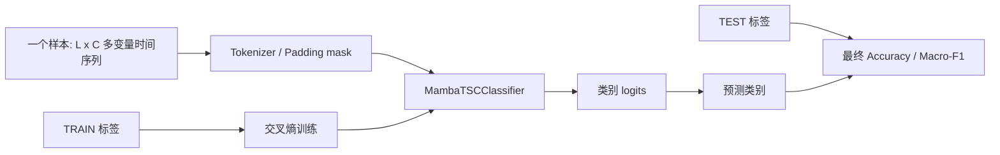

# `data/UEA` 十个数据集分析

## 1. 先说明：这些数据集用于什么任务

`data/UEA` 下的十个数据集都来自 UEA 多变量时间序列分类（Multivariate Time Series Classification）集合。在当前 Mamba-NAS 项目中，它们被统一处理为**有监督的多变量时间序列分类任务**：



其中：

- `L` 是时间长度；不同数据集、甚至同一数据集的不同样本，`L` 可能不同；
- `C` 是变量/通道数，例如传感器、频谱频带、MFCC 系数或脑电通道；
- 每个样本只有一个类别标签，不是逐时间点标注；
- 模型输入形状为 `[batch, length, channels]`，补齐位置由 `mask` 标记；
- 搜索阶段只读取 `*_TRAIN.ts`，并在 TRAIN 内部做 holdout 或 K-fold；
- 代表架构确定后，重训练阶段才读取 `*_TEST.ts`，最终计算测试集指标。

当前代码入口是：

```text
load_train()                 → 只加载 TRAIN
stratified_inner_split()     → 固定 80/20 划分
stratified_kfold_splits()    → 共享分层 K-fold
load_test_for_refit()        → 仅在 refit 阶段加载 TEST
```

## 2. 数据规模总览

下面的数量是根据当前 `data/UEA/*/*_TRAIN.ts` 和 `*_TEST.ts` 实际统计得到的，而不是只引用数据集文档中的理论数量。

| 数据集 | 任务类型 | TRAIN / TEST | 类别数 | TRAIN 通道数 | 序列长度 |
|---|---|---:|---:|---:|---:|
| EthanolConcentration | 酒精浓度四分类 | 261 / 263 | 4 | 3 | 1751（定长） |
| FaceDetection | Face / Scramble 二分类 | 5890 / 3524 | 2 | 144 | 62（定长） |
| Handwriting | 26 个英文字母分类 | 150 / 850 | 26 | 3 | 152（定长） |
| Heartbeat | 正常 / 异常心音二分类 | 204 / 205 | 2 | 61 | 405（定长） |
| JapaneseVowels | 9 位说话人分类 | 270 / 370 | 9 | 12 | 7–26（变长，batch 内补齐） |
| PEMS-SF | 星期一至星期日七分类 | 267 / 173 | 7 | 963 | 144（定长） |
| SelfRegulationSCP1 | negativity / positivity 二分类 | 268 / 293 | 2 | 6 | 896（定长） |
| SelfRegulationSCP2 | negativity / positivity 二分类 | 200 / 180 | 2 | 7 | 1152（定长） |
| SpokenArabicDigits | 阿拉伯数字 1–10 十分类 | 6599 / 2199 | 10 | 13 | 4–93（变长，batch 内补齐） |
| UWaveGestureLibrary | 8 种手势分类 | 120 / 320 | 8 | 3 | 315（定长） |

### 类别平衡概况

| 数据集 | TRAIN 类别分布特征 | 对训练/评价的影响 |
|---|---|---|
| EthanolConcentration | 四类几乎均衡（65/65/66/65） | Accuracy 与 Macro-F1 差异通常不会特别大 |
| FaceDetection | 完全均衡（2945/2945） | 二分类 Accuracy 具有较好的可读性 |
| Handwriting | 26 类且每类仅 2–11 个 TRAIN 样本 | 极易受划分和随机种子影响，必须关注 Macro-F1 |
| Heartbeat | abnormal 147、normal 57，明显不平衡 | Accuracy 可能偏向多数类，Macro-F1 更重要 |
| JapaneseVowels | TRAIN 每位说话人 30 个，均衡 | TEST 各说话人数量不均衡，需关注类别级指标 |
| PEMS-SF | 七类约 32–44 个 | 类别有轻微不平衡，Macro-F1 仍更稳妥 |
| SelfRegulationSCP1 | 135 / 133，基本均衡 | 二分类指标相对直接 |
| SelfRegulationSCP2 | 100 / 100，完全均衡 | Accuracy 与 Macro-F1 接近 |
| SpokenArabicDigits | 每类约 659，基本均衡 | 数据量最大，模型和搜索结果相对稳定 |
| UWaveGestureLibrary | 每类正好 15 个，完全均衡 | TRAIN 很小但类别平衡；5-fold 每类验证样本约 3 个 |

## 3. 十个数据集逐项说明

### 3.1 EthanolConcentration

**现实问题：非侵入式判断酒精浓度。**

- 数据来自 44 个真实威士忌瓶中的水-乙醇溶液光谱；
- 四个类别分别代表 `35%`、`38%`、`40%`、`45%` 酒精浓度，对应标签 `E35/E38/E40/E45`；
- 每个样本有 3 个通道，长度 1751；每个通道是光谱读数；
- 光谱覆盖紫外、可见光到近红外波段，采样间隔约 0.5 nm；
- 同一瓶子存在重复测量，数据集还提供了按瓶子留出的评估设定，目的是判断模型能否对未见过的瓶子泛化。

在当前项目里，这是一个四分类时序任务：模型输入三路光谱曲线，输出四个浓度类别的 logits。由于同一瓶子可能有重复测量，随机样本划分可能让相近的重复读数同时出现在 TRAIN 和 validation 中，正式实验应特别关注按瓶子分组的划分是否更符合目标场景。

### 3.2 FaceDetection

**现实问题：从脑磁图（MEG）试次中判断被试看到的是人脸还是打乱图像。**

- 数据来自 Kaggle 的脑科学竞赛；
- TRAIN 包含约 10 位被试，TEST 来自另外约 6 位被试；
- 每个试次是 1.5 秒 MEG 记录；
- 原始数据有 306 个传感器通道、375 个时间点；当前 `.ts` 文件中每个实例解析为 144 个变量、长度 62；
- 两个类别为 `Face` 和 `Scramble`，当前标签写作 `1` 和 `0`。

这是一个二分类任务，但真正的泛化难点是**跨被试泛化**。如果同一被试的样本同时出现在训练和验证中，模型可能学习被试特征，而不是真正的人脸响应模式。当前 Mamba-NAS 的通用随机分层划分没有显式按 subject 分组，因此结果解释时不能直接等价为严格的跨被试评估。

### 3.3 Handwriting

**现实问题：根据智能手表运动传感器轨迹识别书写的英文字母。**

- 每个样本是书写一个英文字母时的运动轨迹；
- 三个通道是手表加速度计的 `x/y/z`；
- 共 26 个类别，对应英文字母；
- TRAIN 只有 150 个样本，TEST 有 850 个样本；
- 当前文件中每个样本长度为 152。

这是一个 26 分类任务，而且 TRAIN 极小：平均每个类别只有约 5.8 个样本。模型很容易记住轨迹细节，K-fold 的验证方差也可能很大。这里不能只看整体 Accuracy，最好同时报告每个字母的 F1、混淆矩阵以及不同随机种子的波动。

### 3.4 Heartbeat

**现实问题：根据心音判断正常还是异常。**

- 数据源自 PhysioNet/CinC Challenge 2016；
- 录音来自健康受试者和具有心脏疾病诊断的病人；
- 每段录音截取 5 秒，再转换为 spectrogram；
- 当前每个样本有 61 个通道，每个通道可以理解为一个频率带，长度为 405；
- 两个类别是 `normal` 和 `abnormal`；
- 当前 TRAIN 为 `abnormal=147`、`normal=57`，存在明显类别不平衡。

这是当前十个数据集中需要特别谨慎的任务之一：

1. 样本总数只有 204；
2. 输入通道达到 61，参数和输入维度相对较大；
3. 少数类 normal 只有 57 个 TRAIN 样本；
4. Accuracy 容易被多数类 abnormal 主导；
5. 在 K-fold 中每个验证折的少数类样本数量有限，Macro-F1 波动会很大。

因此当前 Mamba-NAS 对 Heartbeat 应优先看 Macro-F1、normal 类 recall/F1、混淆矩阵和多种子均值，而不能只看 Accuracy。

### 3.5 JapaneseVowels

**现实问题：根据日语元音发音识别说话人。**

- 9 位日本男性说话人分别发出元音 `a` 和 `e`；
- 原始语音经过 12 阶线性预测分析，得到 12 维时间序列；
- 每个样本的有效长度不完全相同，当前文件中约为 7–26；
- 类别 `1`–`9` 表示说话人身份，而不是元音类别；
- TRAIN 每位说话人 30 个样本，TEST 中各说话人样本数不均衡。

这是一个 9 分类的 speaker identification 任务。当前 `data.py` 会把每个样本的多通道数组保留下来，在 batch 拼接时进行 padding，并用 mask 区分有效时间点。因此模型需要学习短时语音动态模式，同时忽略补齐位置。

### 3.6 PEMS-SF

**现实问题：根据一天的交通占用率判断星期几。**

- 数据来自加州交通部门 PEMS；
- 覆盖约 15 个月，每 10 分钟采样；
- 每个样本对应一天的交通记录；
- 963 个通道对应持续可用的传感器位置；
- 每天有 144 个时间点，即 24 小时 × 每小时 6 个采样点；
- 七个类别对应星期一至星期日。

这是一个典型的超高维多变量时序分类任务：输入为 `[144, 963]`，即一天内 963 个传感器的交通占用率。它的难点不是序列长度特别长，而是通道数极高。当前搜索空间中的 `d_model`、patch 和 Mamba block 数会直接影响这种高维输入的压缩和建模能力。

需要注意：星期几标签带有明显的日历/周期先验。如果随机抽取日期，TRAIN 和 validation 的季节、月份或相邻时段分布可能相似；若研究严格时间外推，应改用按时间顺序的划分，而不是普通随机分层 K-fold。

### 3.7 SelfRegulationSCP1

**现实问题：根据 EEG 慢皮层电位判断受试者要让光标向上还是向下。**

- 数据来自 Tübingen 自我调节慢皮层电位实验；
- 健康受试者通过脑电控制屏幕上的光标；
- 六个通道，长度 896，对应 3.5 秒、256 Hz 的片段；
- 两个类别为 `negativity` 和 `positivity`；
- 任务信号与视觉反馈相关。

这是一个 EEG 二分类任务。数据量约 268 个 TRAIN 样本，类别基本均衡，模型需要从低频、幅度较弱的脑电变化中区分两种自我调节方向。预处理、归一化和随机种子对结果可能有较大影响。

### 3.8 SelfRegulationSCP2

**现实问题：在另一种实验对象上判断慢皮层电位的负向/正向调节意图。**

- 实验对象为人工呼吸的 ALS 患者；
- 任务仍是让光标向上或向下；
- 七个通道，长度 1152，对应 4.5 秒、256 Hz 的片段；
- 两个类别仍为 `negativity` 和 `positivity`；
- 同样属于 EEG 慢皮层电位分类。

与 SCP1 相比，SCP2 的对象和实验条件不同，通道数、序列长度也不同。它不能简单理解为 SCP1 的重复测试，而更像是在不同受试者/实验条件上的迁移泛化问题。若将两个数据集合并训练，需要额外处理通道语义和分布差异；当前 Mamba-NAS 是分别搜索和评估的。

### 3.9 SpokenArabicDigits

**现实问题：识别说话人读出的阿拉伯数字。**

- 数据来自 UCI，包含 44 位男性和 44 位女性阿拉伯语母语者；
- 每个样本表示 10 个数字之一，即 `1`–`10`；
- 每个时间帧由 13 个 MFCC（Mel-frequency cepstral coefficients）组成；
- 当前序列长度约为 4–93，属于变长序列；
- TRAIN 有 6599 个样本，是十个数据集中规模最大的一个；
- 类别基本均衡，每个数字约 659 个 TRAIN 样本。

这是一个十分类语音识别任务，但不是大词汇量语音识别，而是封闭集合的单数字分类。它是当前十个数据集中最适合稳定进行 K-fold 搜索的一个：每个类别样本多，Fold 指标方差通常较小。其主要计算特点是序列较短、通道只有 13，较小的 patch/Mamba 架构也可能达到很高的性能。

### 3.10 UWaveGestureLibrary

**现实问题：根据三轴加速度计轨迹识别八种简单手势。**

- 每个样本来自加速度计；
- 三个通道是 `x/y/z` 运动坐标；
- 每条序列长度 315；
- 共 8 个手势类别；
- TRAIN 只有 120 个样本，每类正好 15 个；
- TEST 有 320 个样本，每类正好 40 个。

这是一个小样本、完全类别平衡的八分类动作识别任务。TRAIN 很小，因此 5-fold 时每个验证 Fold 中每类只有约 3 个样本，单 Fold Macro-F1 会明显跳动；但 TEST 每类有 40 个样本，最终测试指标相对稳定。当前 Mamba-NAS 中 patch16 往往可以有效压缩轨迹序列，但不能仅凭单次 Fold 分数判断架构优劣。

## 4. 这些数据集在当前 Mamba-NAS 中的训练/测试流程

### 4.1 搜索阶段

对任意一个数据集，搜索阶段做的是：

```text
读取 <dataset>_TRAIN.ts
    ↓
字符串标签映射为整数标签
    ↓
holdout 80/20 或共享 Stratified K-fold
    ↓
只用训练部分拟合归一化统计量
    ↓
为每个候选 Genome 构建 MambaTSCClassifier
    ↓
训练并在 validation/Fold 上预测
    ↓
计算 Macro-F1、Accuracy、Parameters、MACs
    ↓
NSGA-II 优化 OOF Macro-F1 与 MACs
```

K-fold 模式下，同一个候选架构会被重新初始化 K 次：

```text
Fold 1 train → Fold 1 validation
Fold 2 train → Fold 2 validation
...
Fold K train → Fold K validation
```

每个样本的验证预测来自一个训练时没有见过它的模型，所有 Fold 预测合并后形成 OOF 预测。候选主评分是整体 OOF Macro-F1，Fold 均值和标准差作为附加诊断字段。

### 4.2 最终重训练阶段

搜索结束后，项目从 Pareto 前沿选择：

- `high_f1`：OOF Macro-F1 最高；
- `knee`：归一化精度-成本目标距离理想点最近；
- `low_macs`：MACs 最低。

随后：

```text
读取完整 TRAIN
    ↓
用完整 TRAIN 拟合归一化
    ↓
读取 TEST（这是正常流程中第一次访问 TEST）
    ↓
每个代表架构使用 2021/2022/2023 三个种子重训
    ↓
训练完成后计算 TEST Accuracy / Macro-F1
```

当前项目的 TEST 是**最终评估集**，不是架构搜索验证集，也不应该用于：

- 选择 Genome；
- 选择 Fold 数；
- 选择 dropout、学习率或蒸馏权重；
- 决定训练 epoch；
- 反复试验后挑选最好结果。

## 5. 数据集适合的评价重点

| 数据集 | 最需要关注的指标/协议 | 主要风险 |
|---|---|---|
| EthanolConcentration | 按瓶子分组的泛化、Macro-F1 | 重复瓶子读数导致随机划分过于乐观 |
| FaceDetection | 按被试分组的泛化 | 模型学习 subject identity |
| Handwriting | 每类 F1、混淆矩阵、多 seed | TRAIN 极小且 26 类 |
| Heartbeat | Macro-F1、少数类 recall、类别权重 | 类别不平衡和验证方差 |
| JapaneseVowels | Macro-F1、变长 mask、说话人泛化 | TEST 类别分布不均 |
| PEMS-SF | 时间外推或按日期分组验证 | 随机划分可能泄露相邻日期结构 |
| SelfRegulationSCP1 | 多 seed、被试/试次独立性 | EEG 分布和低信噪比 |
| SelfRegulationSCP2 | 多 seed、跨实验条件泛化 | ALS 患者分布特殊 |
| SpokenArabicDigits | Accuracy + Macro-F1、计算量 | 高精度饱和后微小差异不稳定 |
| UWaveGestureLibrary | 多 seed、Fold 方差、Macro-F1 | 每 Fold 每类样本极少 |

## 6. 对当前项目的实际建议

1. **不要把十个数据集视为同一种难度。** SpokenArabicDigits 的大样本十分类，与 Heartbeat 的小样本不平衡二分类，统计可靠性完全不同。
2. **小样本数据优先报告多种子和置信区间。** 尤其是 Handwriting、Heartbeat、UWaveGestureLibrary。
3. **涉及主体/实体的数据应考虑分组划分。** EthanolConcentration 按瓶子，FaceDetection 按被试，JapaneseVowels 按说话人，EEG 数据按受试者或试次来源。
4. **PEMS-SF 要明确研究目标。** 如果目标是随机日期分类，分层 K-fold 可以使用；如果目标是未来日期预测，应使用时间顺序划分。
5. **继续把 Macro-F1 作为主要搜索指标是合理的。** 这对 Heartbeat、Handwriting、PEMS-SF 等不平衡或多类别任务尤其重要。
6. **MACs 只能作为统一复杂度代理。** 最终报告还应补充参数量、实际 GPU 延迟和峰值显存。
7. **当前默认数据目录要注意。** `constants.py` 中默认值是 `data/mamba_nas/UEA`，而本次实际数据位于 `data/UEA`；运行 CLI 时应显式传入 `--data-dir data/UEA`，或自行调整默认配置。

## 7. 一句话总结

这十个数据集在当前项目中的共同任务是“输入一条带有多个通道的时间序列，预测它所属的整体类别”；但类别语义分别来自光谱浓度、脑磁图、人脸刺激、字母书写、心音、说话人、交通星期、脑电意图、语音数字和手势。搜索阶段使用 TRAIN 内部的 holdout/K-fold 估计架构，重训练阶段才访问 TEST 得到最终泛化结果。真正决定评价可靠性的，不只是样本总数，还包括类别平衡、实体重复、被试/瓶子/说话人分组、时间相关性以及当前随机划分是否符合实际部署场景。
